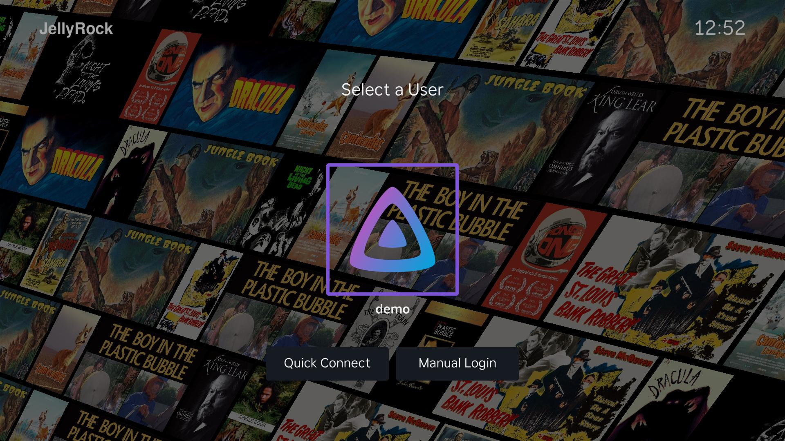
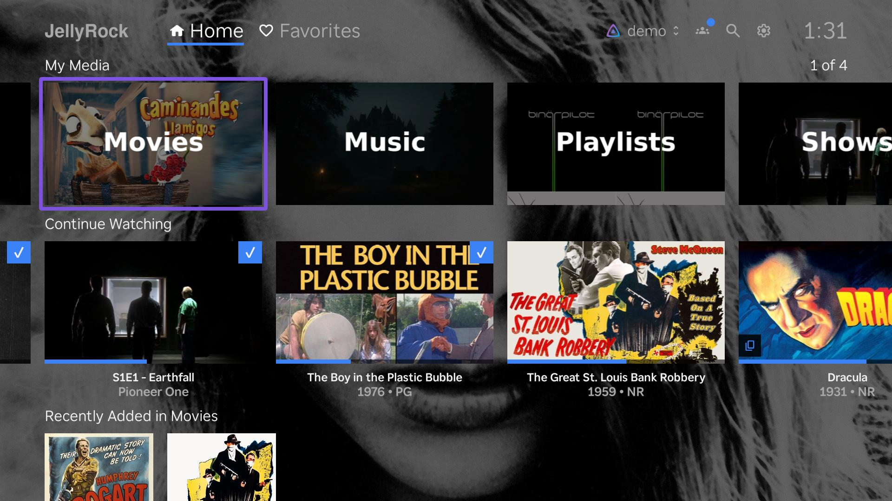
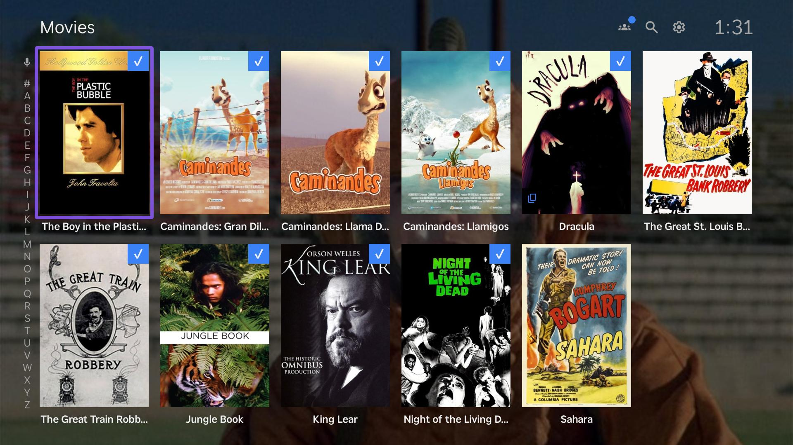
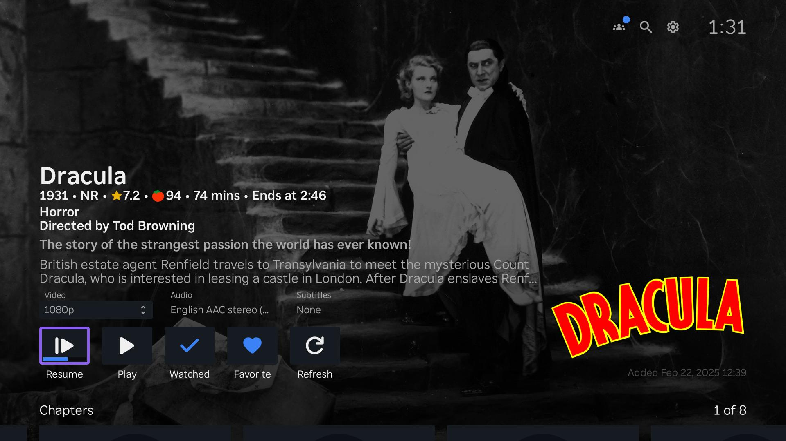
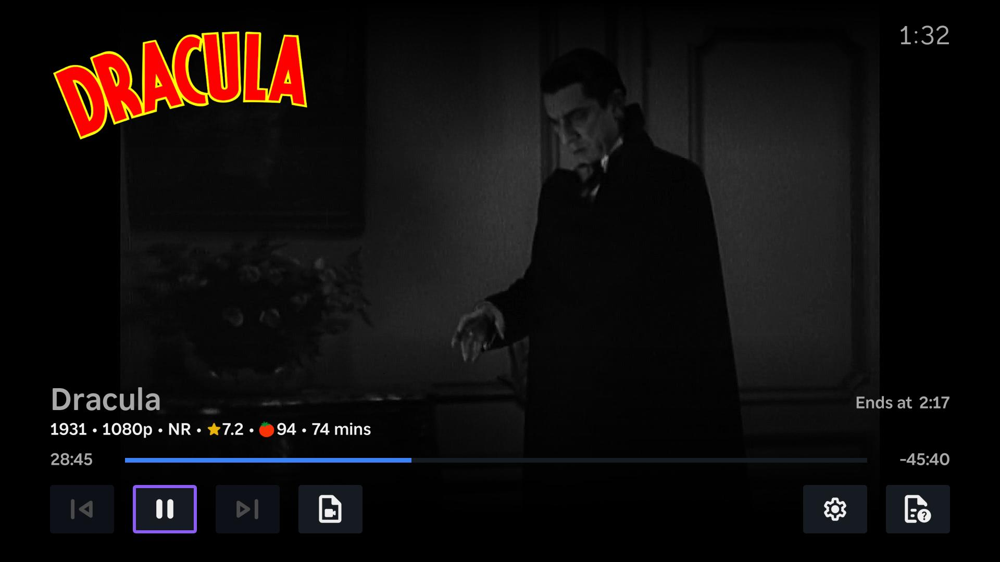

<!-- markdownlint-disable MD041 -->
[](https://channelstore.roku.com/details/232f9e82db11ce628e3fe7e01382a330:a85d6e9e520567806e8dae1c0cabadd5/jellyrock)

[](https://github.com/jellyrock/jellyrock/releases)
[](https://matrix.to/#/#jellyrock-app:matrix.org)
[](https://translate.jellyrock.app/engage/jellyrock/)
[](LICENSE)
[](https://github.com/jellyrock/jellyrock/actions/workflows/build.yml?query=branch%3Amain)
<!-- [](https://translate.jellyfin.org/projects/jellyfin/jellyfin-roku/?utm_source=widget) -->

JellyRock is a Jellyfin client for Roku, from a former maintainer of the original Jellyfin Roku app. It is built to stay smooth: every request to your server runs in the background, so menus keep moving while things load. It plays your media in its original quality whenever your Roku can, and it comes in dozens of languages. It is the first Roku client for Jellyfin with SyncPlay, casting from other Jellyfin apps and display mirroring, on HTTP and HTTPS servers alike. Free and open source, with no ads and no tracking. You need your own Jellyfin server.

## Features

<!-- BEGIN generated features (npm run docs:features) -->

- **[SyncPlay (watch together)](docs/user/features/syncplay.md):** Watch together. Join a SyncPlay group and play, pause and seek in step with people on other Jellyfin apps.
- **[Cast from another Jellyfin app](docs/user/features/cast-to-jellyrock.md):** Cast from a Jellyfin app on your phone or browser to your Roku, then pause, seek and skip from there.
- **[Delete media](docs/user/features/delete-media.md):** Delete a movie, an episode or any other item from your server, from its details page, when your account may.
- **[Watch in original quality](docs/user/features/original-quality.md):** Play your files as they are, with no conversion, whenever your Roku can, and see why when it can't.

See [all features](docs/user/features/index.md).

<!-- END generated features -->

Every feature has a page on [docs.jellyrock.app](https://docs.jellyrock.app/features/), and [jellyrock.app](https://jellyrock.app) has screenshots of them.

## What you need

- A Roku on Roku OS 15.1 or later
- A Jellyfin server, 10.7.0 or later. Some features need a newer one: see the [Jellyfin server feature matrix](docs/user/jellyfin-server-feature-matrix.md).

## Install

### Using your Roku device

- Go to **Home → Search** and search for "JellyRock".

### Using your browser

- Visit the [Roku Channel Store](https://channelstore.roku.com/details/232f9e82db11ce628e3fe7e01382a330:a85d6e9e520567806e8dae1c0cabadd5/jellyrock), select **Add app** and sign in. JellyRock installs on **all** devices linked to your Roku account.

## Companion server plugin (optional)

[JellyRock Companion](https://github.com/jellyrock/jellyfin-plugin-jellyrock) is a plugin for your Jellyfin server. It adds:

- **Cast to JellyRock while it's closed.** Your Roku shows up as a cast target and opens straight into what you picked. Your server must be on the same network as your Roku.
- **Remote control on HTTPS servers.** On an HTTP server, this already works without the plugin.
- **Fast cleanup after you press Home on HTTPS servers.** Jellyfin ends the playback session within about a minute and keeps the right resume point. On an HTTP server, this already works without the plugin.

It needs Jellyfin server 10.11 or later. To install it, and to see the other plugins JellyRock supports, read [Jellyfin Server Plugins](docs/user/jellyfin-server-plugins.md).

## Screenshots

  <a href="docs/screenshots/en_US/userSelect.webp" target="_blank" title="User Select">
    
  </a>
  <a href="docs/screenshots/en_US/home.webp" target="_blank" title="Home">
    
  </a>
  <a href="docs/screenshots/en_US/libraryGrid.webp" target="_blank" title="Library grid">
    
  </a>
  <a href="docs/screenshots/en_US/movieDetails.webp" target="_blank" title="Movie Details">
    
  </a>
  <a href="docs/screenshots/en_US/osd.webp" target="_blank" title="On-Screen Display(OSD)">
    
  </a>
  <a href="docs/screenshots/en_US/trickplay.webp" target="_blank" title="Trickplay">
    
  </a>

**🖼️ [View all screenshots →](docs/screenshots/)**

## Docs

The user docs are at [docs.jellyrock.app](https://docs.jellyrock.app). Beyond the feature pages:

- [App settings](docs/user/app-settings.md)
- [Jellyfin server feature matrix](docs/user/jellyfin-server-feature-matrix.md)
- [Jellyfin server plugins](docs/user/jellyfin-server-plugins.md)
- [Playback troubleshooting](docs/user/playback-troubleshooting.md)

## Translations

JellyRock uses Weblate for translations: <https://translate.jellyrock.app/projects/jellyrock>

[](https://translate.jellyrock.app/engage/jellyrock/)

## History

From 2019 to 2025, I worked on the original Jellyfin client for Roku as a member of the Jellyfin team, and was its sole maintainer for part of that time.

That client is now archived as [jellyfin-roku-legacy](https://github.com/jellyfin-archive/jellyfin-roku-legacy). For its [v3 release](https://github.com/jellyfin/jellyfin-roku/releases/tag/3.0.0), the [official client](https://github.com/jellyfin/jellyfin-roku) adopted a different fork as its new base, one that had branched from the original back at v2.1.4.

JellyRock continues the original's own line. I forked it at [v2.2.5](https://github.com/jellyfin-archive/jellyfin-roku-legacy/releases/tag/v2.2.5), the last release I'd personally vetted as stable, and have rebuilt and refined it independently ever since, cherry-picking select fixes from later commits along the way.

## Sideload / beta test

To run the latest version of JellyRock before it hits the Roku Channel Store:

1. Put your Roku device in [Developer Mode](docs/dev/developer-mode.md). Save your password!
2. Download the latest [build](https://github.com/jellyrock/jellyrock/actions/workflows/build.yml?query=branch%3Amain) created by GitHub Actions. Select the first item listed then click one of the links at the bottom of the page, for example `JellyRock-prod-main-e34f4f169ff47531abd23ae3a11c102f6811f907`. This will download a zip file to your computer.
3. Put your Roku's IP from step 1 into a browser, for example `http://192.0.2.10`, and press enter.
4. Log in with credentials from step 1.
5. Upload and install the zip file downloaded in step 2.

> NOTE: The app will always be at the bottom of your Roku's channel list and it will *not* automatically update.

## Contribute

Start with the [contributing guide](docs/dev/contributing.md). The developer docs are at [dev.jellyrock.app](https://dev.jellyrock.app), and every guide is listed in [docs/architecture/README.md](docs/architecture/README.md#existing-dev-guides).

### Build

```bash
git clone https://github.com/jellyrock/jellyrock.git
cd jellyrock
npm install
# Note: If npm scripts are disabled, manually run `npm run ropm` to install dependencies
npm run build # OR npm run build:prod
```

## Changelog

All notable changes to this project are documented in [CHANGELOG.md](CHANGELOG.md).
